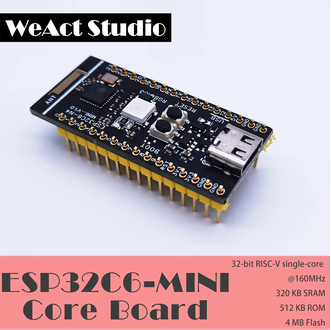
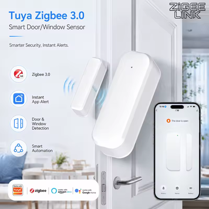

# ESP32 TI ZNP Coordinator

**Status: BETA, with successful tests.** Automated protocol/Python tests, ESP32-C6/H2 builds, and the C6 checksum-boundary and paired-sensor hardware tests have passed. Broader device coverage, sustained reliability testing and H2 radio testing remain unfinished. See the [validation report](docs/LQI_Validation_Report.md) for measured results and tests not yet run.

A WeAct ESP32-C6 presents a CC2652P-style TI ZNP serial interface to the unmodified Zigbee2MQTT `zstack` driver, while its own native Zigbee radio handles real devices. ESP32-H2 is also a build target.

**Arduino IDE by design.** The firmware is a standard multi-file Arduino sketch, intentionally organized for simplicity and reuse across compatible ESP32-C6/H2 boards. Open [TI_ZNP_ESP32_RealBridge.ino](Arduino/TI_ZNP_ESP32_RealBridge/TI_ZNP_ESP32_RealBridge.ino) in Arduino IDE and keep its companion `.cpp`/`.h` files together. Use the pinned Arduino-ESP32 board package and [IDE settings](docs/ARDUINO_SETUP.md). Arduino CLI and CI provide optional automation around the same sketch.

**Target board: WeAct Studio ESP32-C6-MINI.** Tested configuration: 4 MB flash, native USB, and RGB status on GPIO8. Product image supplied by the project owner; WeAct Studio branding belongs to its owner.

**Start here: [Getting Started](docs/START_HERE.md).** On this Windows lab, double-click `Start-Lab.cmd`, then open http://127.0.0.1:8080. Use `Stop-Lab.cmd` before the Python serial utilities or flashing.

**Fresh clone:** follow [setup and prerequisites](docs/FRESH_SETUP.md) and [build/test instructions](docs/BUILDING.md). The Windows shortcuts require a separately installed local lab; they are not an installer. Firmware diagnostics are disabled by default.

Hardware acceptance on 2026-10-18: the C6 formed/resumed the configured network, paired and interviewed a UZ-6D (Wing TS0203), and enrolled its IAS Zone. Unmodified Zigbee2MQTT **2.14.2** with its bundled herdsman **10.10.0** connected through COM17 and Mosquitto **2.1.2**, publishing both contact states and battery reports after an application reflash/restart. Independent unmodified herdsman **11.1.0** adapter/controller tests also passed. The RGB is green at idle and flashes white for received application data, confirmed by the operator.

**Low-cost test sensor: Tuya Zigbee 3.0 door/window sensor, identified as UZ-6D / Wing TS0203.** The project owner reported a **bundle offer below US$4** on 2026-10-18; this is a reported offer, not an independently verified current price. This physical sensor paired directly with the ESP32-C6 and supplied the contact/battery and LQI investigation traffic. See the [sensor identity, supplier reference and measured test results](docs/TEST_SENSOR.md), including the [owner-supplied AliExpress listing](https://www.aliexpress.com/ssr/300000512/BundleDeals2?productIds=1005012531959731%3A12000059134993720). Retail product image supplied by the project owner.

This is verified compatibility for the exercised host/device path, rather than complete TI firmware equivalence or Zigbee certification. Per-device TI security-table backup/restore is incomplete; do not treat a generated coordinator backup as a complete migration image. Dynamic endpoint registration, inter-PAN/touchlink, and broad device-family acceptance remain incomplete. RF power and antenna performance belong to the ESP32 hardware. See the [compatibility matrix](docs/COMPATIBILITY_MATRIX.md).

The LQI investigation correlated **63 live SDK/bridge/encoded/MQTT values**, including 11 genuine raw-zero SDK fields in the bathroom. No cosmetic LQI replacement was needed. A separate valid-checksum `0xFE` receive-decoder defect was reproduced and narrowly corrected in source with exhaustive native regressions. [Its report](docs/ZNP_Checksum_Boundary.md) records native tests, C6/H2 builds, and a separately authorized C6 deployment: the live checksum-boundary test and all six sensor reports from three cycles passed. Diagnostics are OFF on the corrected board. This repository is experimental source, not a completed certified release.

- [Python test instructions and color key](docs/TESTING.md)
- [Go-forward reliability and compatibility test plan](docs/GO_FORWARD.md)
- [LQI/RSSI investigation](docs/LQI_RSSI_Investigation.md), [AF protocol audit](docs/ZNP_AF_INCOMING_MSG_Audit.md), and [LQI validation/rollback](docs/LQI_Validation_Report.md)
- [Installed Windows software, services, start/stop and VM handoff](docs/INSTALLED_SOFTWARE.md)
- [Build and developer checks](docs/BUILDING.md)
- [Ubuntu / VirtualBox USB setup](docs/VM_USB_ZIGBEE2MQTT.md)
- [Serial compatibility](docs/SERIAL_COMPATIBILITY.md) and [RF evidence](docs/RF_ACCEPTANCE.md)
- [Source architecture](docs/ARCHITECTURE.md)

The source separates framing, ZNP dispatch, durable virtual TI NV, radio/ZDO operations, and RGB status. Generated binaries, private network keys, databases, logs, personal screenshots, reference archives, and third-party installations are excluded by `.gitignore`.

Project-authored source and documentation use the [MIT license](LICENSE). ESP-IDF/Arduino, Espressif Zigbee libraries, Zigbee2MQTT, Mosquitto and other separately installed dependencies retain their own licenses. TI reference documents and vendor libraries are not redistributed here. See [contribution guidance](CONTRIBUTING.md).
