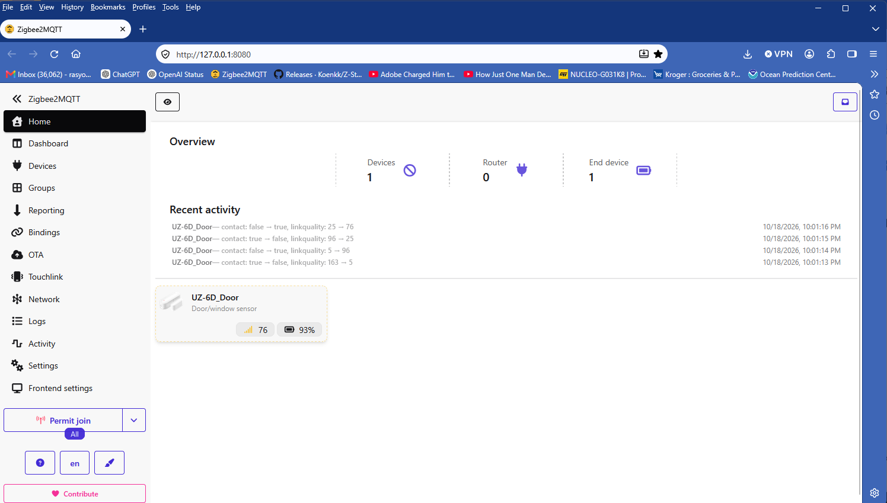

# Working with the emulated TI Zigbee dongle

**The purpose of this project is to let ordinary Zigbee host software operate an ESP32-C6 through a TI CC2652P-style ZNP serial interface.** The tested host is unmodified Zigbee2MQTT using its normal `zstack` driver. The ESP32-C6 runs the real Zigbee network with Espressif's native radio/stack and performs the host-requested operations through our firmware.

## Live application evidence

The project owner supplied this screenshot on 2026-10-18. It is reproduced unchanged, with no reconstructed or generated UI elements. The screenshot displays:

- One end device, zero routers, friendly name `UZ-6D_Door`.
- Four recent alternating contact changes at 22:01:13-22:01:16 local time.
- Latest displayed linkquality 76 and battery state 93%.
- The running frontend at `http://127.0.0.1:8080`.

The corresponding existing MQTT log independently contains the following publications on `esp32_znp_lab/UZ-6D_Door`:

| Local time, 2026-10-18 | MQTT contact | Meaning | Published linkquality | Published battery state |
|---|---|---|---|---|
| 22:01:13 | `false` | Open | 5 | 93% |
| 22:01:14 | `true` | Closed | 96 | 93% |
| 22:01:15 | `false` | Open | 25 | 93% |
| 22:01:16 | `true` | Closed | 76 | 93% |

All four contact states and LQI values match the visible activity sequence. The screenshot lists newest activity first; the table is chronological. A metadata-only [evidence record](evidence/zigbee2mqtt-live-2026-10-18.json) preserves these observations and the image SHA-256. Original logs/databases remain private. The battery value is displayed/published state; these contact events do not independently establish a fresh battery RF measurement. The timestamps are host/UI times, not calibrated RF reception times.

## Where the TI emulation happens

| Stage | Responsibility and observed operation |
|---|---|
| Physical sensor | The UZ-6D / Wing TS0203 sends real Zigbee IAS Zone contact reports |
| ESP32-C6 radio and Espressif stack | Receive RF traffic and supply APS indications; maintain the coordinator's actual network |
| ESP32 firmware: TI ZNP personality | Parse host requests/replies, represent virtual TI NV/state, control startup/discovery/APS operations, and serialize incoming events as `AF_INCOMING_MSG` (`0x4481`) |
| USB serial transport | Carries TI-format binary ZNP frames; tested board uses native USB on Windows COM17, 115200 baud, `rtscts: false` |
| Unmodified zigbee-herdsman `zstack` adapter | Uses the normal TI protocol path; identifies the emulated response as ZStack3x0, receives incoming ZNP messages and exposes device traffic |
| Unmodified Zigbee2MQTT | Interviews/configures the sensor, applies IAS device converters and publishes contact/battery state to MQTT and its web frontend |
| Mosquitto / browser | MQTT subscribers receive published state; the browser displays Zigbee2MQTT's live frontend |

The TI compatibility identity is transport 2, product 1, version 2.7.1, revision 20240710. It deliberately selects a supported host protocol path. The emulation layer runs on the ESP32; the tested Zigbee2MQTT/adapter source is unchanged, and no host serial-translation proxy is used. Network and RF operations are backed by the actual Espressif stack rather than simulated sensor events. See [serial personality details](SERIAL_COMPATIBILITY.md) and [source architecture](ARCHITECTURE.md).

## Tested system and supporting checks

| Component / check | Recorded result |
|---|---|
| Target | WeAct Studio ESP32-C6-MINI / ESP32-C6FH4, 4 MB, RGB GPIO8 |
| Firmware environment | Arduino IDE-compatible sketch; Arduino-ESP32 3.3.11, ESP-IDF 5.5.5, ESP Zigbee library 1.6.8 |
| Full host | Zigbee2MQTT 2.14.2, bundled herdsman 10.10.0, Mosquitto 2.1.2, Windows 11 |
| Real device commissioning | Sensor joined, interview and IAS enrollment passed |
| Host/device retention | Existing network/device resumed through the exercised app-only updates without re-pairing |
| LQI investigation | All 63 captured SDK/bridge/encoded/MQTT values agreed, including 11 raw SDK zeros; separate evidence, not inferred from this screenshot |
| Corrected serial decoder | Live valid-checksum FE frame followed immediately by PING passed without retry |
| Controlled corrected-build smoke test | Three counted sensor cycles produced all six expected alternating contact publications |
| This later UI example | Four additional visible activity entries matched existing MQTT log metadata as tabulated above |

These observations answer different questions: the Python identity probe checks serial exchange; native tests check protocol behavior; successful commissioning and real sensor traffic check the network/application path; the screenshot makes the resulting host operation visible. The combined evidence demonstrates useful real end-to-end compatibility for the exercised configuration.

## Scope and next tests

The project remains **beta**. The ESP32 does not execute TI firmware or reproduce a CC2652P board's RF amplifier. Full TI MT command coverage, complete per-device security backup/migration, additional device/router families, long-duration reliability, H2 RF operation and Ubuntu/VirtualBox acceptance remain separate work. A working screenshot does not certify those capabilities or determine physical event loss/latency without a counted, timestamped trial.

Use [Getting Started](START_HERE.md) to reproduce the Arduino IDE and Zigbee2MQTT setup, [the sensor record](TEST_SENSOR.md) for the inexpensive test unit, [RF acceptance](RF_ACCEPTANCE.md) for measured scope, and [the go-forward plan](GO_FORWARD.md) for broader validation. Preserve the existing network and paired device during routine testing.
